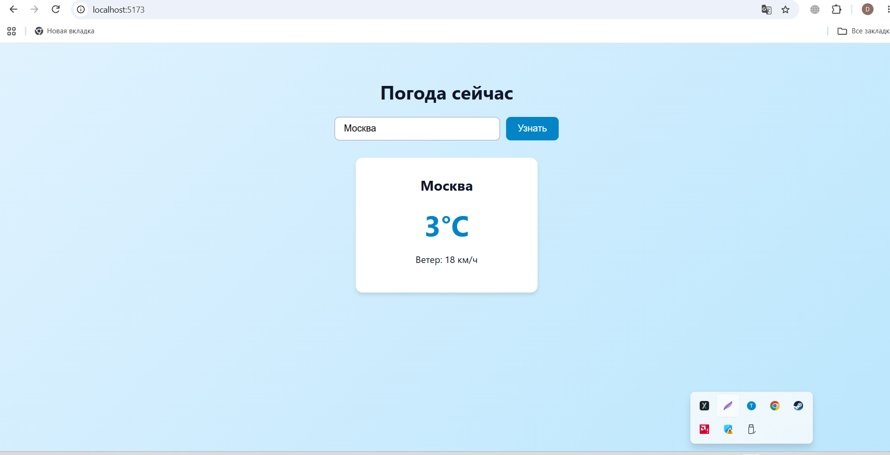
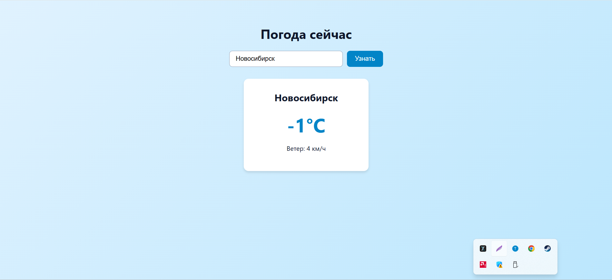

# Weather React App

Приложение для просмотра текущей погоды в любом городе. Написано на React (Vite).

## Демо
*(Ссылка появится после деплоя на Vercel)*

## Стек
- React
- Vite
- Open-Meteo API (бесплатное API погоды)

## Что умеет
- Поиск города по названию
- Показ текущей температуры и скорости ветра
- Обработка состояний загрузки (loading) и ошибок (город не найден)